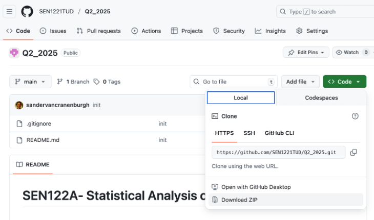
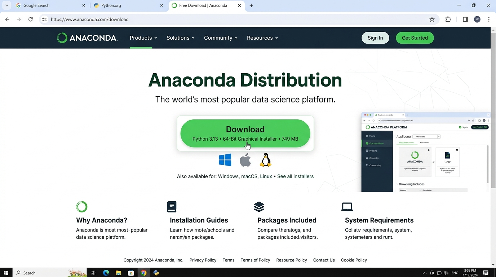
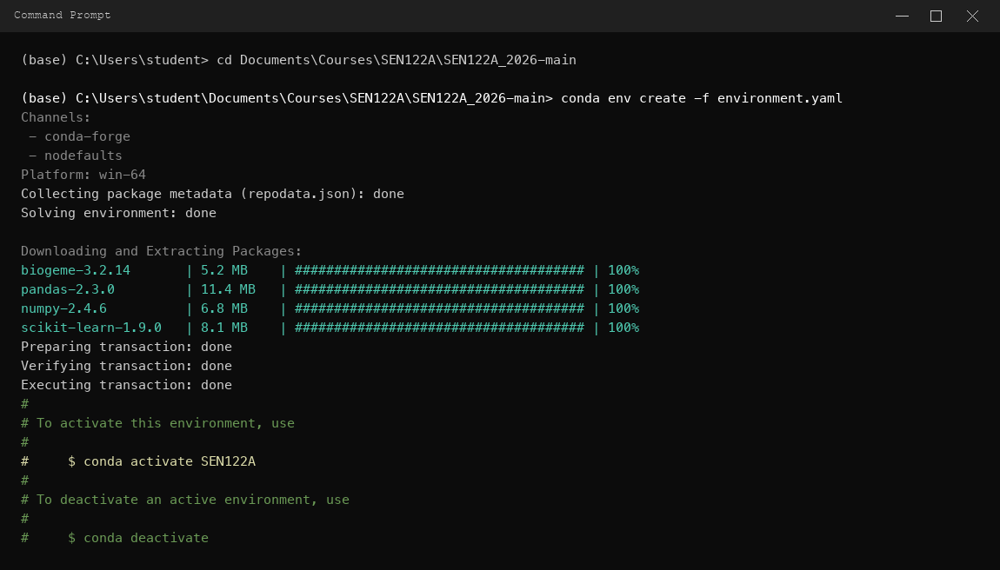
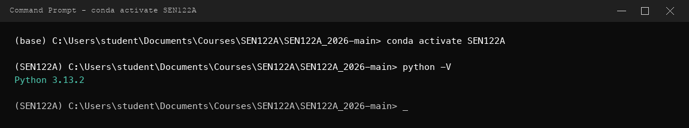
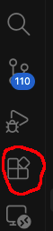
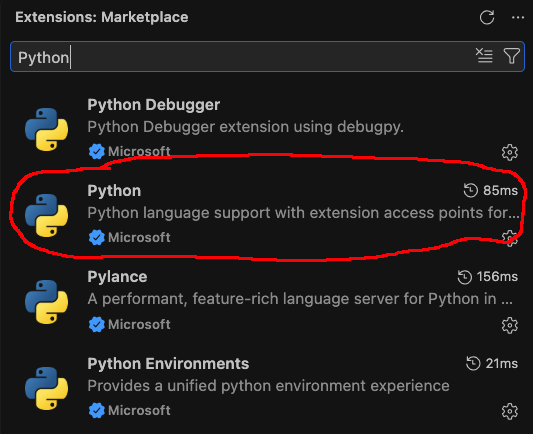
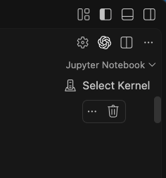
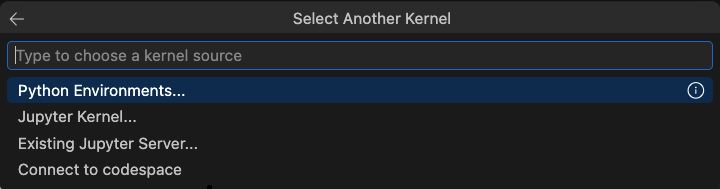

## Instructions to set up your Python environment

This section explains how to configure the Python environment used in the Choice Behaviour Modelling part of the course. You only need to complete this setup **once**. The same environment will work for **all lab sessions**.

### Setting up Python environment using Anaconda and Conda

Anaconda is a popular platform for managing Python environments and packages. We use `conda` together with the provided `environment.yaml` file to create the complete course environment in one step — this will install **Python 3.13.X** and all required packages automatically.

> **Do NOT reuse an environment from another course.** Package conflicts from other environments are a common source of problems.

Step-by-step instructions:

#### A. Download the lab session files

1. **Go** to: [SEN1221TUD/SEN122A_2026 course repository](https://github.com/SEN1221TUD/SEN122A_2026)

2. **Download the course materials**
   - Click the green **Code** button in the top-right corner of the page.
   - In the dropdown, select **Download ZIP**.
     

3. **Locate the downloaded ZIP file**
   - By default, the file will be saved in your **Downloads** folder.
   - The file is named: `SEN122A_2026-main.zip`

4. **Move/Copy the ZIP file to your course folder**
   - Open File Explorer (Windows) or Finder (Mac).
   - Move/copy the ZIP file to a convenient location. We suggest you create a main folder for the course first. For example: `Documents/Courses/SEN122A/SEN122A_2026`.
   - ⚠️ **Do NOT place the folder on a cloud-synced drive** (OneDrive, Dropbox, iCloud) — this can cause issues with Conda.

5. **Extract the ZIP file**
   - Right-click the ZIP file and choose **Extract All...**
   - Inside the extracted folder you should see the subfolders: `Lab_sessions`, `Assets`, and the `environment.yaml` file.

**Keep the complete folder structure intact. The notebooks use this structure to locate datasets and other required files.**

#### B. Install Anaconda (if not already installed)

0. **Install Anaconda**:
   - Go to the [Anaconda download page](https://docs.anaconda.com/anaconda/install/).
   - Choose the appropriate version and click Download.
   - Run the installer and follow the instructions.

   

#### C. Create the Python environment from `environment.yaml`

The `environment.yaml` file is included in the downloaded course repository. It specifies Python 3.13 and all required packages — everything is installed in a single command.

1. Open the **Anaconda Prompt** (Windows) or **Terminal** (Mac/Linux).
   - On Windows: search for _Anaconda Prompt_ in the Start menu and open it.
   - On Mac/Linux: open the standard Terminal application.

2. Navigate to the **root folder** of the extracted course repository. For example:

   ```
   cd Documents/Courses/SEN122A/SEN122A_2026-main
   ```

3. Create the environment by running:

   ```
   conda env create -f environment.yaml
   ```

   This will create a conda environment named **`SEN122A`** and install all required packages. **Be patient — this may take several minutes.**

   

4. Once finished, activate the environment:

   ```
   conda activate SEN122A
   ```

   Your prompt should now show `(SEN122A)` at the beginning.

   

> **Alternative (no Conda):** If you prefer not to use Conda, a `requirements_SEN.txt` file is also provided in the repository. You can install packages into an existing Python 3.13 environment using:
> `pip install -r requirements_SEN.txt`

#### D. Install Visual Studio Code and its extensions

1. Go to the [Visual Studio Code download page](https://code.visualstudio.com/Download) and download the installer for your operating system.

2. Run the downloaded installer and follow the installation steps. When it is finished, open **Visual Studio Code**.

3. On the far-left edge of the VS Code window, find the vertical icon bar called the **Activity Bar**. Click the **Extensions** icon: it looks like four small squares, with one square separated from the other three.

   

4. The Extensions panel opens on the left. Click the search field at the top, type `Python`, and press Enter. In the results list, find **Python** with **Microsoft** shown underneath its name. Click that result, then click the blue **Install** button. Wait until the button changes to **Uninstall**; this confirms that it has been installed.

   

   Optionally, several other Python extensions, such as **Pylance**, can also be installed to enhance the development experience.

5. Click the Extensions search field again, type `Jupyter`, and press Enter. In the results list, find **Jupyter** with **Microsoft** shown underneath its name. Click that result, then click the blue **Install** button. Wait until the button changes to **Uninstall**.

#### E. Start your lab session

1. Open Visual Studio Code.

2. Select **File** → **Open Folder...** and **CHOOSE the ROOT FOLDER of the course repository** (e.g. `Documents/Courses/SEN122A/SEN122A_2026-main`). This is the folder that contains `Lab_sessions`, `Assets`, `environment.yaml`, and the other course folders. **Do NOT** open `Lab_sessions` or an individual lab-session folder directly.

3. In the Explorer sidebar, open the `Lab_sessions` folder and locate the lab notebook you want to work on (a file ending in `.ipynb`).

4. Select the notebook to open it in VS Code.

5. In the top-right corner of the notebook, select **Select Kernel** and choose the Python environment you created.

   

6. Click **Python Environments** and select the **SEN122A** environment from the list.

   

7. You can now run notebook cells using the play button next to each cell.
